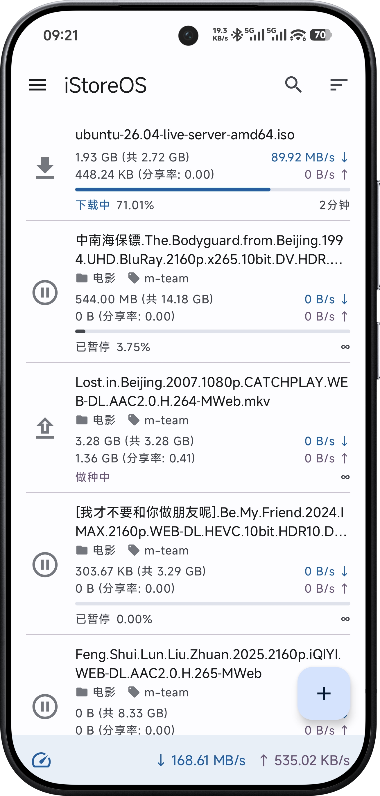
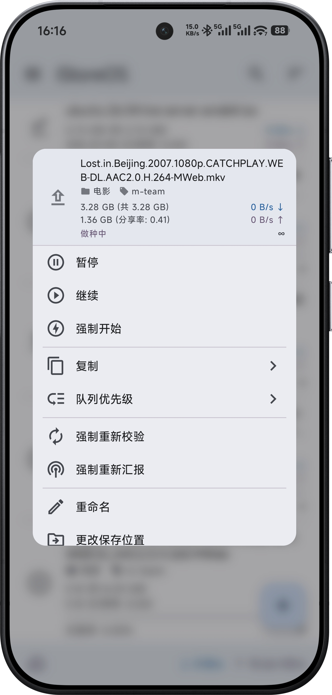
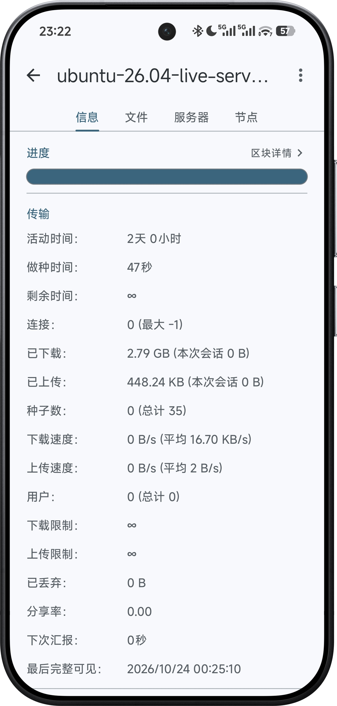
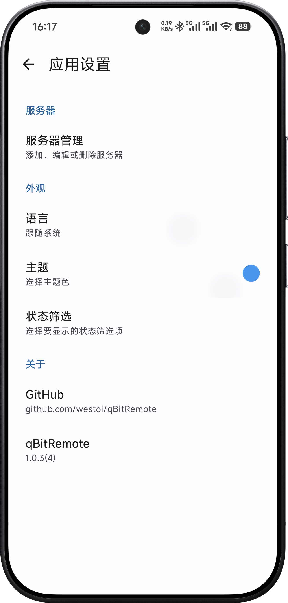

<h1 align="center">
  
   
  qBitRemote — a native Android remote client for qBittorrent
</h1>

<h3 align="center">
A <a href="https://www.qbittorrent.org/">qBittorrent</a> remote client built with <a href="https://kotlinlang.org/">Kotlin</a> + <a href="https://developer.android.com/compose">Jetpack Compose</a>
</h3>

<h3 align="center">
<a href="README.md">简体中文</a>&nbsp;|&nbsp;English
</h3>

## Features

- **Lightweight & clean**
    - 2.61 MB APK; no ads, no telemetry, no crash reporting — every connection goes directly to your own qBittorrent
- **Complete management**
    - Multiple servers with Android Keystore-encrypted credentials and isolated sessions
    - Live torrent list: search, status/category/tag filters, multi-select batch actions
    - Torrent detail: Info / Files / Trackers / Peers views + piece-progress bar; file priorities, rename
    - Tracker & peer management (incl. permanent ban/unban), queue priorities, seeding/speed/share limits, .torrent export
- **Server settings mirror the WebUI**
    - Speed (global & alternative limits, scheduling), Connection (port, UPnP, connection caps, IP filtering)
    - BitTorrent (DHT/PeX/LSD, encryption, anonymous mode, torrent queueing, seeding limits, auto-append trackers)
    - Downloads (default save path, TMM policies, .torrent backups)
- **Experience**
    - 简体中文 / 繁體中文 / English switchable in-app; 17 theme colors + dynamic color (Android 12+)
    - Share / open-with / magnet links feed straight into the add panel; qB server log viewer

## Install

- [Download from GitHub Releases](https://github.com/westoi/qBitRemote/releases/latest)

### Requirements

- Android >= 8.0
- qBittorrent 4.x (Web API 2.9+); 5.x works with a few 5.x-only settings absent

### Language files

The three string resources live under [`app/src/main/res/`](app/src/main/res/): `values/` (English), `values-zh-rCN/` (Simplified Chinese), `values-zh-rTW/` (Traditional Chinese).

## Issues / Feature requests

- [Report an issue](https://github.com/westoi/qBitRemote/issues)

## Donate

Buy the developer a coffee ☕

## Projects

### Acknowledgements — qBitRemote is built on or inspired by:

- [qBittorrent](https://www.qbittorrent.org/): the free, open-source BitTorrent client
- [Jetpack Compose](https://developer.android.com/compose) / [Material 3](https://m3.material.io/): modern declarative UI on Android
